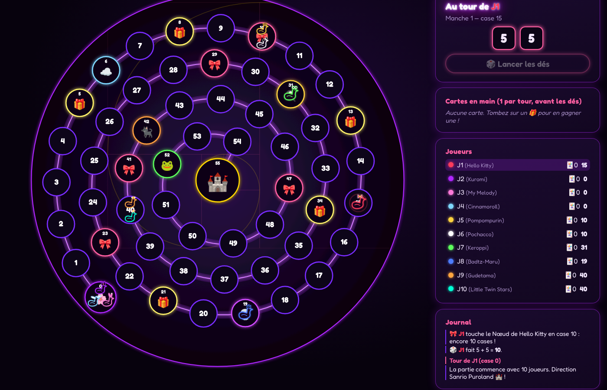

# L'Oie Néon × Sanrio

Jeu de l'oie personnalisable réalisé pendant l'atelier « Créer un jeu de l'oie avec l'aide de l'IA », en s'inspirant de [VibeOie](https://github.com/tspriet/VibeOie).

## Lancer le jeu
Ouvrez `index.html` dans un navigateur (Chrome, Firefox, Edge, Safari). Il n'y a rien à installer.

## En bref
- 2 à 10 joueurs, chacun avec un pseudo et une oie déguisée en personnage Sanrio.
- Plateau de 55 cases en spirale de Fibonacci, avec l'arrivée au centre (🏰 Sanrio Puroland).
- 2 dés et un rebond si on dépasse la case 55.
- Cases spéciales : 🎀 Nœud de Hello Kitty, ☁️ Nuage de Cinnamoroll, 💀 Piège de Kuromi, 🍳 Sieste de Gudetama, 🐈‍⬛ Labyrinthe de Chococat, 🐸 Flaque de Keroppi, 🎁 Cadeau Sanrio.
- 9 cartes actions à garder en main, comme au Mille Bornes : 3 au maximum, 1 jouée par tour avant de lancer les dés.

Les règles complètes sont dans [CAHIER_DES_CHARGES.md](CAHIER_DES_CHARGES.md) et dans le bouton « 📜 Règles » du jeu.

## Tests réalisés
- Saisie : nombres refusés (1, 11, 0, -3, 2.5, vide), pseudo vide, pseudos en double, costumes en double.
- Règles : rebond, victoire pile sur 55, Nœud de Hello Kitty (y compris les enchaînements), Nuage de Cinnamoroll, Piège de Kuromi (2 tours), Sieste de Gudetama (libération par un autre joueur), Labyrinthe de Chococat, Flaque de Keroppi.
- Cartes : les 9 effets, la limite d'une carte par tour, l'annulation, les protections (Mélodie, puis Câlin), la défausse quand la main est pleine.
- 12 parties complètes jouées au hasard sans erreur, et affichage vérifié sur téléphone (390 px).

Le jeu de test expose `window.OIE` (état du jeu, dés forcés) pour les tests automatiques.
